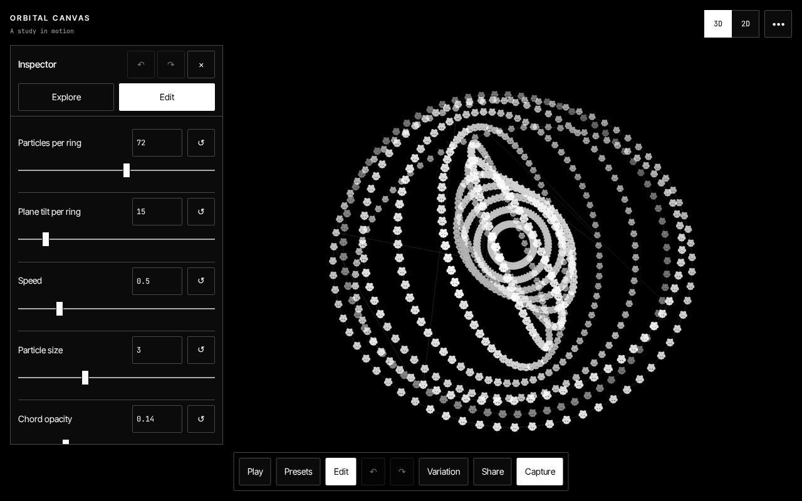
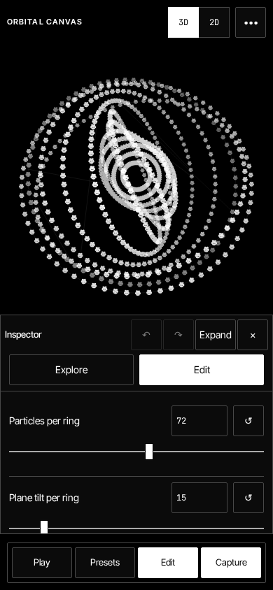

# Orbital Canvas

A monochrome editor for generative orbital compositions, built with JavaScript, Vite and
Canvas2D. One three-dimensional simulation, two projections: a perspective orbit camera and
a flat orthographic view onto the XY plane. Switching projection preserves the scene.



Inspired by [Geometría Aurea](https://instagram.com/geometria_aurea/).

## Run locally

Use Node.js 24 and npm:

```bash
npm ci
npm run dev
```

`npm run build` produces `dist/`, which any static host can serve. Fonts and preset previews
are bundled locally; the application requires no backend or external service.

Build installs must include development dependencies and run install scripts. `npm ci`
checks the exact Mediabunny **1.51.0** pin and applies the tracked `patch-package` cleanup
patch. Review that patch and rerun dependency and browser acceptance before changing the pin.
A deployed `dist/` needs no npm installation.

## Explore and edit

The artwork fits the space between the header, transport and open inspector. On desktop the
inspector sits beside it; on smaller screens it becomes an expandable bottom sheet. The
interface uses opaque surfaces, hairline borders and inversion for active states. **Hide UI**
opens the whole canvas, with a visible Show UI button and an Escape exit.

- **Presets** offers four visual starting points. Editing displays **Custom**; **Reapply**
  applies the last chosen preset again, even when it already matches.
- **Edit** exposes six essential controls, followed by collapsible Form, Motion and Style
  sections. Scene settings contain projection-independent lifecycle and range choices.
- Density, plane tilt, inner hole and ring spacing update existing rings immediately,
  preserving identity, phase and time. Changing spawn mode or static ring count rebuilds.
- **Inner hole** and **Ring spacing** are relative to an outer radius of one. Generative
  scenes cycle through radial slots while orientation follows a separate bounded sequence.
- **Generative** starts with a complete population, then replaces the oldest rings on an
  interval with a fade. **Restart introduction**, under More, deliberately starts at one ring.
  **Static** distributes an exact ring count evenly from the outer ring to the inner hole.
- **Variation** makes bounded changes to active numeric parameters. Strength selects the
  maximum relative range adjustment; colour, shape and camera remain under direct control.
- Numeric values can be typed, sliders reset on double-click, and each control/group has an
  explicit reset. Particle colour includes **Auto**, which follows the selected appearance.
- **Undo / Redo** retain up to 50 committed edits. A slider drag or camera gesture is one edit.
  History covers parameters, projection, appearance, manual camera settings and restoring
  defaults. Animation time and trail pixels are runtime state, outside history.
- **Safe** enforces a 4,000-particle limit including fading rings. Returning from Experimental
  clamps parameters and removes the oldest excess rings immediately. Experimental allows
  broader ranges and displays a particle warning. Glow can reduce frame rate in either mode.
- Trails use a time-based luminance half-life, so the setting has consistent timing across
  frame rates. A periodic additive sweep prevents permanent grey trails on white.



The shell stays monochrome. Explicit particle colours and chromatic chords add colour only
to the artwork. A first visit with reduced motion enabled opens a complete, paused scene
with automatic camera motion disabled.

## Keyboard, touch and focus

| Key / gesture           | Action                                                    |
| ----------------------- | --------------------------------------------------------- |
| Space                   | Play / pause when focus is outside an interactive control |
| P                       | Open / close Edit                                         |
| 2 / 3                   | Choose projection                                         |
| ?                       | Help, gestures and preferences                            |
| F / H                   | Full screen / hide or show UI                             |
| R / S                   | Variation / save current PNG                              |
| 0 / double-click canvas | Reset camera                                              |
| Ctrl/Cmd+Z              | Undo                                                      |
| Ctrl/Cmd+Shift+Z        | Redo                                                      |
| Escape                  | Cancel export, close a dialog/panel, or exit Hide UI      |
| Drag / swipe canvas     | Orbit in 3D                                               |
| Wheel / pinch canvas    | Zoom in 3D                                                |
| Arrows / + / −          | Orbit / zoom when the canvas has focus in 3D              |

Character shortcuts work after clicking buttons. Space and Enter retain native button
activation; text fields retain typing and native undo. Form controls, composition input,
modified shortcuts and open dialogs do not trigger unrelated character actions. Help lets
users disable character shortcuts and enable measured FPS diagnostics. Modal dialogs contain
focus and restore it to their trigger on close. Touch controls have 44px targets.

## Save and share

The version-2 document stores scene parameters, projection, Safe/Experimental mode,
appearance and camera pose/motion. Sharing uses the **current** camera pose. Opening a link
recreates the composition with a fresh simulation; it does not reproduce the sender's
current animation time or accumulated trails. Use PNG to preserve an exact visual frame.

On startup a valid version-2 hash takes precedence over the local document, then system-aware
defaults. An invalid or unsupported link opens defaults with a message rather than silently
opening an unrelated saved composition. Any subsequent edit stores synchronously and clears
the shared hash so reload uses the edited local document. Storage failure is announced.
Sharing uses the native share sheet where available, then clipboard, then a selectable link.

This is a breaking format change: old links and saved documents have no reader or migration.
The new keys are `orbital-canvas:document:v2` and `orbital-canvas:preferences:v2`. Editor
preferences (expanded groups, shortcuts, diagnostics and capture choices) are separate from
the shareable document. The early appearance script reads the same version-2 authority
before paint and updates the browser theme colour.

## Capture

One Capture dialog previews both output types and pauses the editor until it closes.

| Output | Contents                                                                                 | Size and timing                                                           |
| ------ | ---------------------------------------------------------------------------------------- | ------------------------------------------------------------------------- |
| PNG    | Exact current artwork buffer, including accumulated trails                               | Native artwork resolution; excludes HUD and inspector                     |
| Video  | Fresh reproducible simulation with a full ring population at frame zero and empty trails | Independent resolution and clock; leaves editor time and phases untouched |

Video offers **Screen**, **1920×1080**, **1080×1080**, and **1080×1920**. Screen preserves the
artwork aspect ratio, capped at a 1920px long side and 2,073,600 pixels. It does not upscale
small artwork. All video dimensions are even. The preview uses the selected aspect ratio;
editor framing never becomes an export offset. Resizing the window or changing DPR during
export does not cancel or resize the detached capture canvas.

Duration is an integer from **1–120 seconds**, with **24 / 30 / 60 / 120 FPS**. The default is
6 seconds at 30 FPS. The work budget is `1920 × 1080 × 60 × 30` pixel-frames: at full HD,
30 FPS allows 60 seconds, 60 FPS allows 30 seconds, and 120 FPS allows 15 seconds. The dialog
shows the actual duration limit for the chosen size/FPS and explains invalid combinations
without silently changing the input. Encoded payload is capped at **60 MiB**, with a final
**64 MiB** file guard; an overflow stops capture with an actionable message.

WebCodecs through [Mediabunny](https://mediabunny.dev) owns the clock, encoding exactly
`duration × fps` frames. Frame zero renders at time zero; subsequent frames advance by
`1/fps`. Codec preference is AVC, AV1, VP9, VP8; MP4/WebM extension follows the actual container.
If the browser cannot encode through WebCodecs, MediaRecorder captures the same detached
canvas in real time. Its frame count may vary under load; keep the tab visible. Hiding a tab
cancels real-time capture with an explanation.

During export the dialog locks its settings and offers Cancel; Escape also cancels. Success,
failure and cancellation release resources and allow another export. Closing Capture
restores the editor's previous playing/paused state. Destroying the app cancels capture
without resuming animation or downloading a success.

The Mediabunny patch covers the TypeScript source and ESM path used by the app. On a failed
finalization it attempts forced source cleanup before propagating the original error; a
cleanup failure is logged separately and does not mark the source closed. This guarantee
covers the app's `BufferTarget` use, not arbitrary streaming/file targets. The patch also
closes temporary native encoder/frame resources used by Firefox codec probes.

Inspect a downloaded clip with:

```bash
ffprobe -v error -count_frames -select_streams v:0 \
  -show_entries stream=nb_read_frames,r_frame_rate,width,height \
  -of default=nw=1 orbital-canvas-*.mp4
```

## Code and verification

| Area                         | Responsibility                                                       |
| ---------------------------- | -------------------------------------------------------------------- |
| `src/core/`                  | DOM-free configuration, ring geometry, phases, spawning and budgets  |
| `src/view/`                  | Camera, projection, DPR-aware viewport, shapes and time-based trails |
| `src/ui/controls.js`         | Spec-driven controls and edit gestures                               |
| `src/ui/history.js`          | Bounded transactional undo/redo                                      |
| `src/ui/permalink.js`        | Version-2 validation, persistence, links and preferences             |
| `src/ui/capture.js`          | Output limits and detached reproducible capture scene                |
| `src/ui/recorder.js`         | Export strategy, download and MediaRecorder cleanup                  |
| `src/ui/webcodecs-export.js` | Lazy-loaded Mediabunny/WebCodecs pipeline                            |
| `src/main.js`                | Composition, live rendering, focus, layout and user actions          |

The renderer draws in a 720-unit logical space fitted to the artwork rectangle. Camera zoom
and geometry are dimensionless, so export resolution changes retain the visual composition.
Ring orientation uses `seq % 48`; radial slots cycle independently. Ring IDs stay monotonic
and removal keeps a contiguous oldest-first prefix, preserving chord indexing. Time enters
through `dt`; phase integrates speed, and cached trigonometry avoids work per particle.

```bash
npm run lint
npm run format:check
npm test
npm run build
npx playwright install chromium firefox webkit
npm run smoke
npm run smoke:firefox
npm run smoke:webkit
```

Playwright is pinned locally; `ffprobe` and `ffmpeg` must be on PATH. Browser acceptance runs
source-backed application probes and production-bundle captures. It checks focus and
shortcuts, live geometry, history, colours, version-2 sharing/persistence, reduced motion,
seven viewport sizes in both appearances, exact PNG bytes, deterministic detached frames,
work limits, failed native encoder recovery, resize/DPR independence, MediaRecorder motion,
cancellation and destruction. WebCodecs-specific probes explicitly skip engines without that
API; native MediaRecorder cases require that API, and its absence is covered by an explicit
error-and-recovery check. Downloaded clips, screenshots and
JSON receipts remain in the printed temporary directory. Automated viewport/touch emulation
does not replace acceptance on physical mobile devices.

Unit tests cover simulation/geometry/projection, controls schema, history, versioned
serialization, budgets, capture limits and renderer/encoder failure paths. The installed
Mediabunny regression tests replace only native resources to check original error identity,
flush failures and resource closure. Pre-commit runs lint, formatting and unit tests; CI also
builds and runs a Chromium/Firefox/WebKit browser matrix.

`npm run visuals` regenerates deterministic preset previews plus desktop dark/light and
mobile screenshots from the current source. It uses the same local browser harness; a build
must exist first. Review generated assets before committing.

## License

[MIT](LICENSE). Made by [MrCabss69](https://github.com/MrCabss69).
The maintained repository is `Intrinsical-AI/OrbitalCanvas`; original
`MrCabss69/OrbitalCanvas` history is retained as the `upstream` remote.

Bundled Inter Tight and JetBrains Mono fonts retain their SIL Open Font License 1.1.
Mediabunny and the tracked changes to it retain MPL-2.0. Each production build includes
their notices and licenses, plus the installed, patched Mediabunny TypeScript source,
under `dist/licenses/`. The editor's Help dialog links to these notices.
